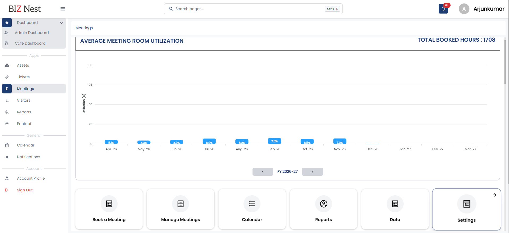
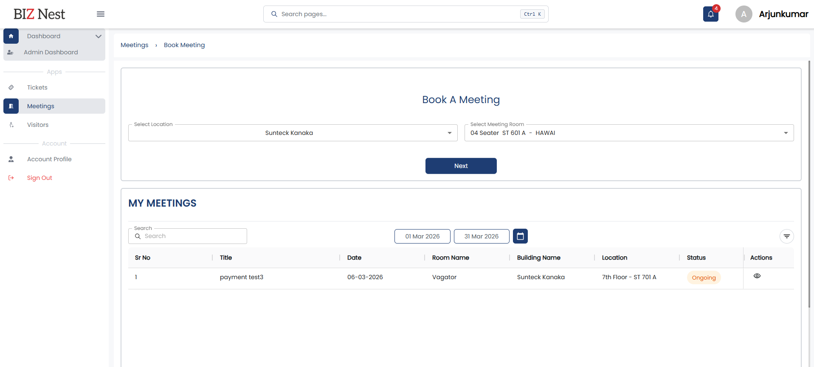
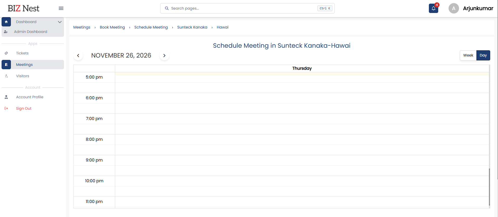
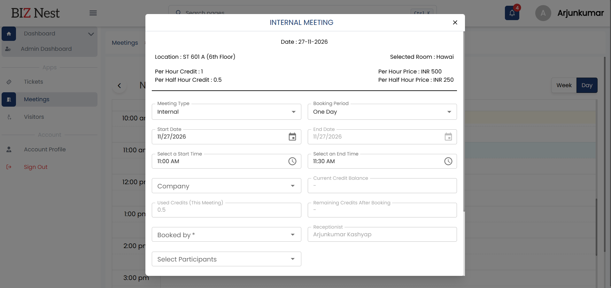
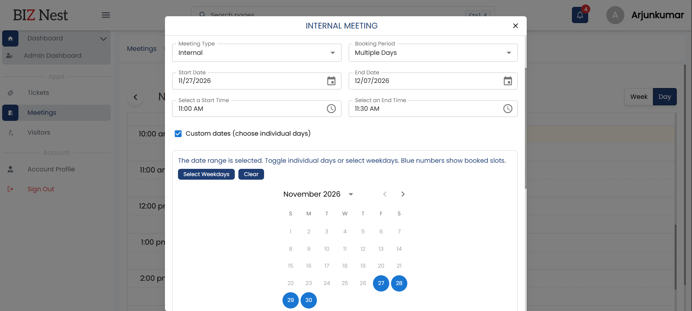
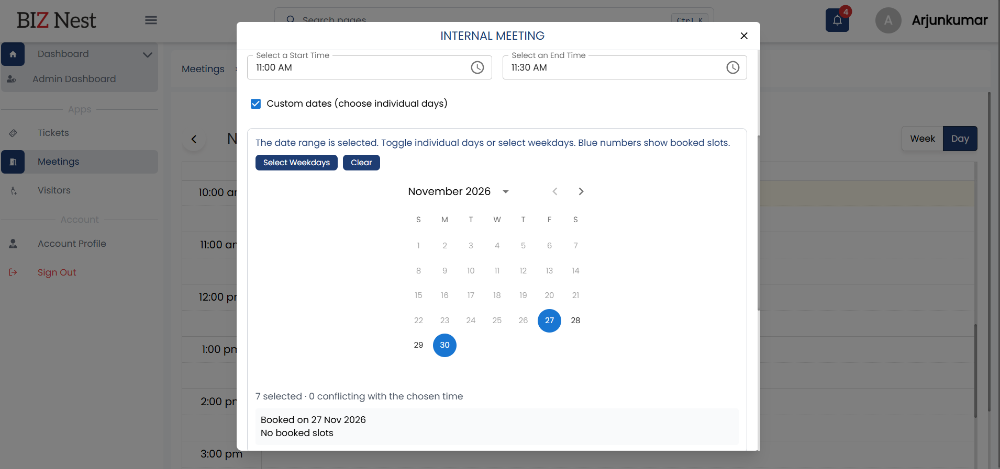
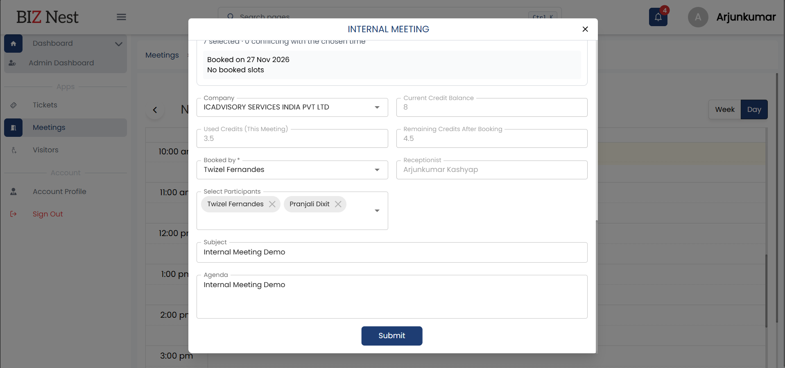
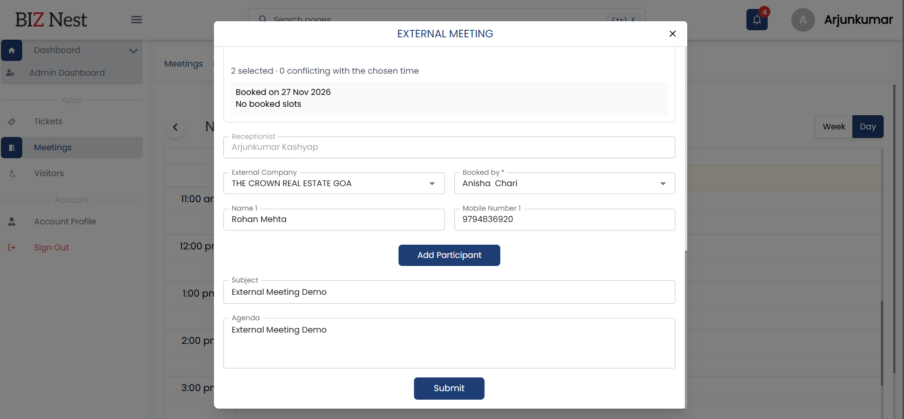
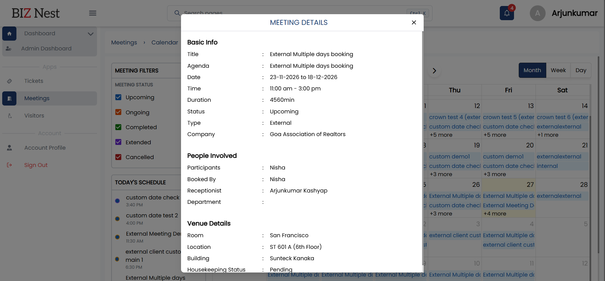

# Book a Meeting Userflow

Last updated: 26 November 2026

This workflow covers selecting a meeting room, choosing available dates and times, and submitting an internal or external booking.

### Common navigation

1. User: Open Meetings and select the **Book a Meeting** card.

   

2. User: On the booking page, choose Select Location, then Select Meeting Room.

   

:::note

The room list depends on the selected location. The meeting schedule opens after a room is selected.

:::

### Choose a date and time

Pick an available slot for the selected room.

1. User: Follow Common navigation, then choose a slot in the room schedule. Switch between **Week** and **Day** if needed.

   

2. User: In the meeting form, confirm Start Date and End Date, then set Select a Start Time and Select an End Time.Check the selected room, location, and displayed hourly credit and price before completing the booking.

   

:::note

For a one-day booking, the end date stays the same as the start date. The start time cannot be in the past, and the end time must be later than the start time. A conflicting room slot cannot be submitted.

:::

### Book multiple days, if available

Choose a continuous date range or individual dates at the same time of day.

1. Eligible user: In Booking Period, choose Multiple Days and set Start Date and End Date.

   

2. Eligible user: To omit dates within the range, select Custom dates (choose individual days). Toggle dates in the calendar, or use **Select Weekdays** and **Clear**.Review the selected-day count and any time conflicts before continuing.

   

:::note

The multi-day controls are available only to Administration users, Tech Admin, and specifically authorised users. Otherwise the form uses a one-day booking without showing Booking Period. The calendar shows booked slots for the room; selected conflicting dates must be removed or their times changed. A booking accepts at most 100 selected dates. Multiple selected days are submitted as one booking with its selected slots.

:::

### Complete an internal meeting booking

Add the internal booking details and submit the meeting.

1. User: In Meeting Type, keep Internal.

- Confirm Company and the displayed credit balance.
- Fill the available booker and Select Participants fields, then enter Subject and Agenda.
- Select **Submit**. After a successful booking, the app opens the meeting calendar.

  

:::note

The booker and company fields vary by the user's role and company. Check the displayed credits before submitting; booking does not create a visitor entry.

:::

### Complete an external meeting booking

Associate an external client with the meeting and submit it.

1.  Authorised user: In Meeting Type, choose External

- Select External Company.
- Confirm Booked By, add any external participant names and mobile numbers, and enter Subject and Agenda.
- Select **Submit**. After a successful booking, the app opens the meeting calendar.

  

### Meeting Calendar

1. Authorised user: After a successful booking, the app opens the meeting calendar.

   

:::note

The External option is shown only to users with access to it. Payment details are handled separately from this booking form.

:::
