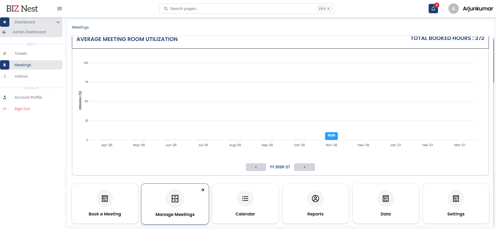
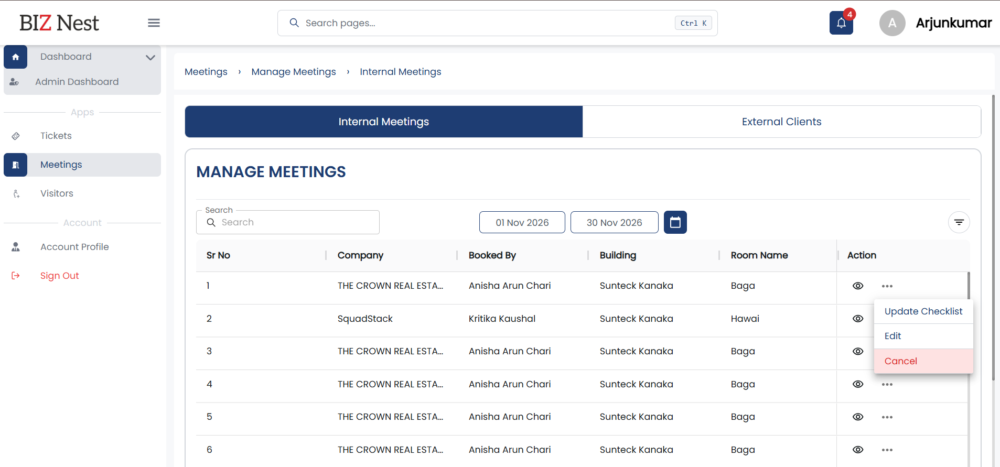
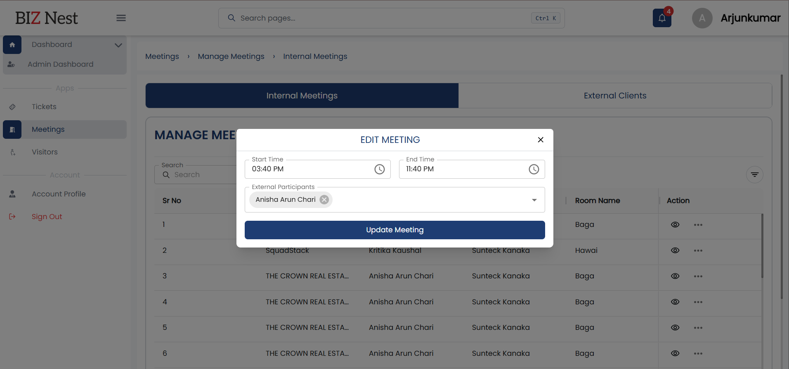
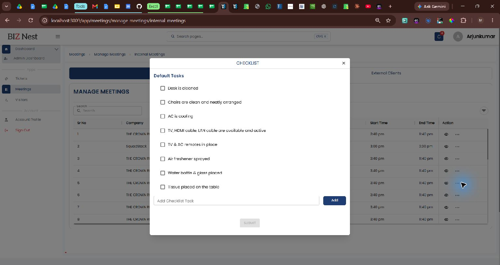
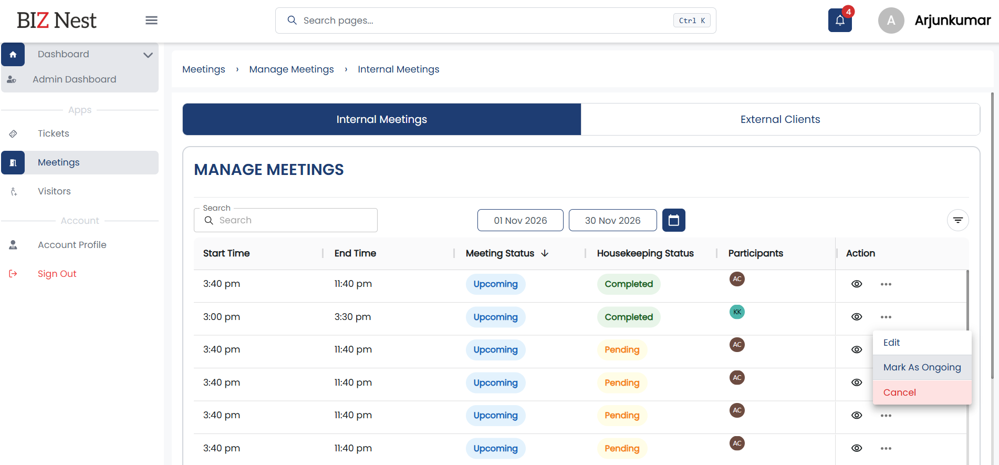
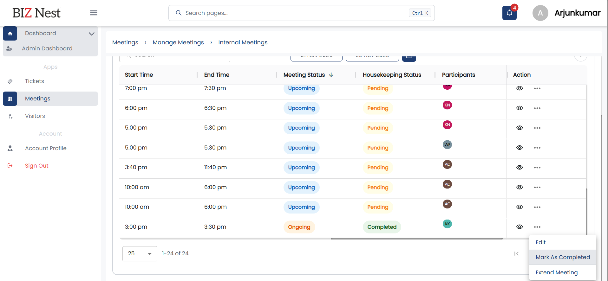
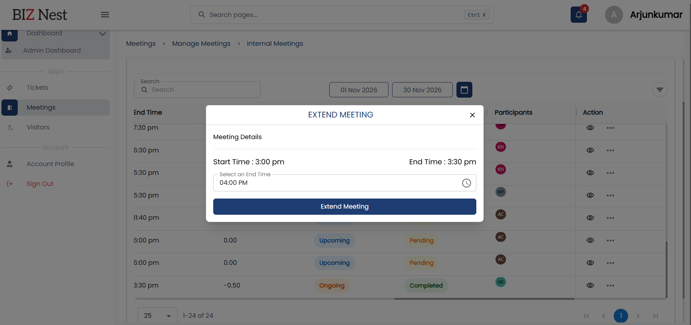
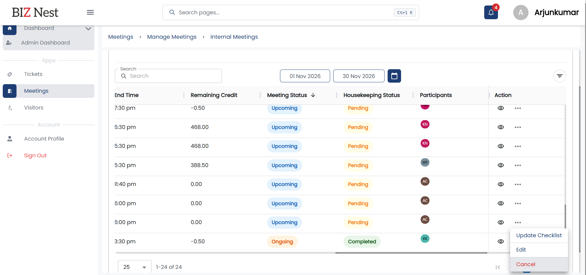
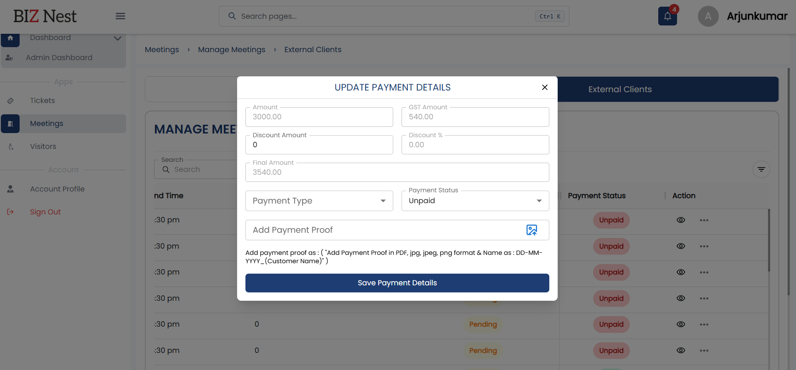

# Manage Meetings Userflow

Last updated: 27 November 2026

This workflow covers viewing and editing bookings, completing housekeeping, updating meeting statuses, extending or cancelling meetings, and recording payments for external meetings.

### Common navigation

1. Open **Meetings** and select the **Manage Meetings** card.

   

2. Select **Internal Meetings** or **External Clients**. Use the date range and search to find the booking. The **Action** column has an eye icon for details and a three-dot menu for available updates.

   

:::note

Available actions depend on your access, the booking type, the meeting status, and the scheduled time.

:::

### Edit an internal meeting

1. Open the three-dot menu and select **Edit**. Update **Date** if your role allows it, then review **Start Time**, **End Time**, and **Participants**. Select **Update Meeting** to save the changes.

   

:::note

Timing changes depend on your role and the meeting's start time. Completed single-slot meetings may still offer **Edit** with restricted timing fields. Bookings with multiple slots have fewer actions.

:::

### Update the housekeeping checklist

1. Open the three-dot menu and select **Update Checklist**. Check the completed tasks. To add a task, enter it in **Add Checklist Task**, select **Add**, and check it when complete. Remove any custom tasks you added by mistake. Select **Submit** and verify that **Housekeeping Status** shows **Completed**.

   

### Update the meeting status

1. Once the scheduled start time has arrived and housekeeping is complete, open the three-dot menu and select **Mark As Ongoing**. Verify that **Meeting Status** changes to **Ongoing**.

   

2. When the meeting ends, select **Mark As Completed** when available and verify the **Completed** status. For internal bookings with multiple slots, this action becomes available after the final slot ends.

   

### Extend an internal meeting

1. Open the three-dot menu and select **Extend Meeting**. Review the current meeting times, choose a later time in **Select an End Time**, and select **Extend Meeting**. Verify the updated end time in the table.

   

:::note

The internal meeting menu offers this action for eligible single-slot bookings after they leave **Upcoming**.

:::

### Cancel an internal meeting

1. For an eligible **Upcoming** booking, open the three-dot menu and select **Cancel**. Enter the required **Reason**, select **Cancel Meeting**, and verify that **Meeting Status** shows **Cancelled**.

   

### Record payment for an external meeting

The **External Clients** tab shares the internal workflow for viewing details, editing, updating housekeeping, marking meetings ongoing or completed, and cancelling eligible bookings. In the edit form, use **External Participants** for client attendees. The additional action is **Update Payment Details**.

1. In **External Clients**, find the unpaid booking, open the three-dot menu, and select **Update Payment Details**.

2. Review the calculated **Amount** and **GST Amount**. Enter **Discount Amount** if applicable, then check the calculated **Discount %** and **Final Amount**. Select **Payment Type** and set **Payment Status** to **Paid** or **Unpaid**. Use **Add Payment Proof** to attach a PDF, JPG, JPEG, or PNG named using the `DD-MM-YYYY_(Customer Name)` format. Select **Save Payment Details**, then open the meeting details to review the saved payment information.

   

:::note

Finance users can progress a paid booking through **Review Payment**, **Verify Payment**, and **Completed**, as each action becomes available.

:::
