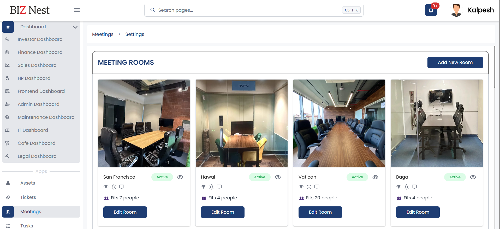
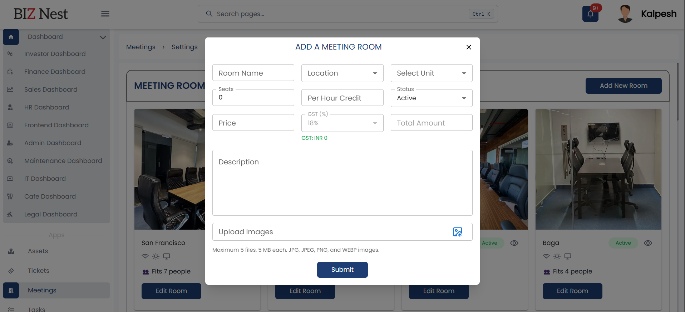
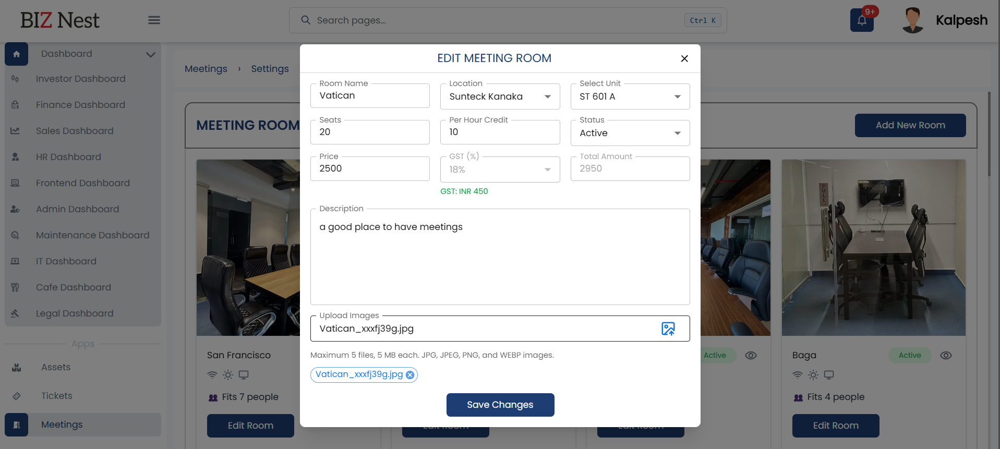

# Meeting Settings Userflow

Last updated: 27 November 2026

This workflow covers adding a meeting room and updating its location, capacity, booking rate, status, description, and photos.

### Common navigation

1. Open **Meetings** and select the **Settings** card. The **Meeting Rooms** page displays the configured rooms.

   

### Add a meeting room

1. Select **Add New Room**. In **Add a Meeting Room**, enter the details and review the calculated **Total Amount**, which includes the displayed 18% **GST (%)** and select **Submit**.

   

2. Confirm the app shows **Room added successfully!** and the new room appears in **Meeting Rooms**.

### Edit a meeting room

1. Find the room in **Meeting Rooms** and select **Edit Room** on its card. In **Edit Meeting Room**, review **Room Name**, **Location**, **Select Unit**, **Seats**, **Per Hour Credit**, **Status**, **Price**, and **Description**. Change the applicable fields and check the recalculated **Total Amount** if the price changes. Use **Upload Images** to keep, remove, or add room photos. Select **Save Changes**.

   

2. Reopen the room to verify the saved changes.

:::note

**Settings** requires Meetings Settings access. **Edit Room** is available to Tech department users. The unit list depends on the selected location. The upload control accepts up to five JPG, JPEG, PNG, or WebP images, with a limit of 5 MB per image.

:::
